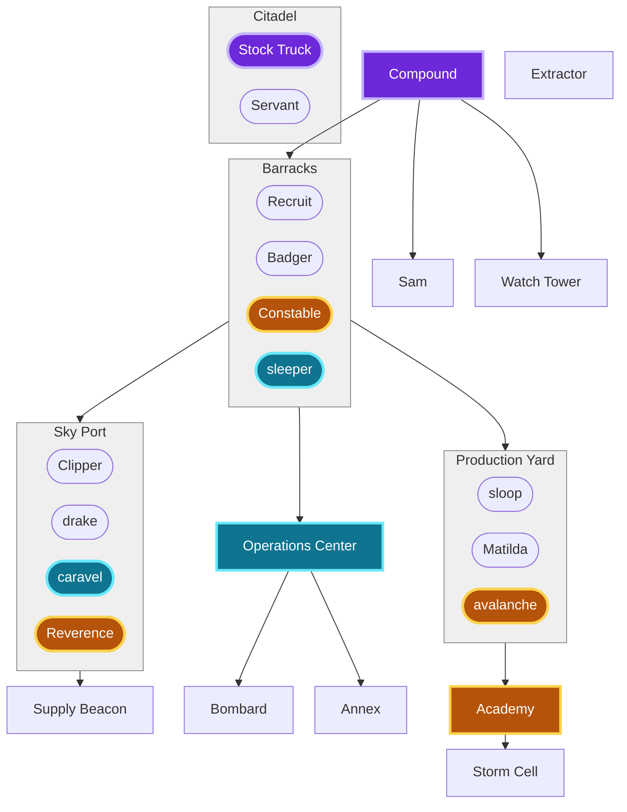

# Colonials

Generic id `colonial`; in-game title "Colonials" (the **Haustoria** of the
world-building lore — see [[world-building#Haustoria]]).

# Introduction
[[world-building#Haustoria|haustoria]]
# Overview
| **Themes**   | Siege, Sprawl, Constitution       |
| ------------ | --------------------------------- |
| **Minion**   | Vulnerable Vehicle                |
| Infrastructure       | internment camps                  |
| **Dominion** | Collect neutral or enemy infantry |
- Doctrine
	- Bombardment
	- Supply Lines
	- Cryogenics
- Asymmetric Mechanics — see §Asymmetric mechanics below, one per faction slot
- Unique Mechanics
	- Artillery spotting system
	- Cryogenics as slowing and strengthening
	- Unit and energy shipments
# Asymmetric mechanics

The Colonial version of each faction slot ([matchups](../../design-framework/matchups.md)
§Faction slots); the one-line form is `slots:` above. Drafted 2026-10-17 from the piece docs and
system notes — TODO: review for correctness.

### Dominion generation — prisoners
The Stock Truck captures light BIO infantry by running it down — neutral Terrestrials from
Shelters, or enemy soldiers — carries them in its cage, and deposits them at a
[[cl_infrastructure|Compound]]. Each captive serves a 30 s sentence there, paying dominion as it
serves (150 in all), one captive at a time, and is consumed at the end. A Servant can be interned
too, as a deliberately inefficient fallback (200 energy for 150 dominion). Destroying a Compound
frees its captives to the side they were taken from.
→ [colonial-dominion](../../systems/combat/colonial-dominion.md)

### Secondary economy — shipments
The Supply Beacon (`cl_support2`) is a long-term investment that casts [[drop|Drop]]: units flown
in to a point of the player's choosing, up to a pair of Matildas at the top level. It turns energy
into presence without production time or travel. TODO: the energy half of "unit and energy
shipments" is not designed.

### Disable — Freeze
A frozen piece is stunned and wrapped in 150 hp of ice that resists as STRONG armour, for 10 s or
until the ice breaks; STRONG pieces cannot be frozen. Applied by the [[freeze|Freeze]] ordnance
(any unit or structure), the Avalanche's frost field (units only, friend or foe, after 2 s of
exposure), and [[blizzard|Blizzard]] (a field after a 10 s warning). (The Cryogenic Implosion superweapon
shares the cryo theme but deals damage rather than freezing.) It is two-sided: it locks an enemy down for the Bombard, or shields a friendly unit.
→ [shields](../../systems/combat/shields.md)

### Mobility — absent, on purpose
Colonial ground forces are slow and few of them fly. What stands in for mobility is reach without
movement: Bombard fire wherever a spotter can see, Drop shipments, and the Caravel's heavy air
transport.

### Garrison clearing — the Sleeper and the shell
The Sleeper storms enemy-held garrisons (`flushes: true`). Bombard shells can clear a garrison
too.

### Stealth — the Sleeper
A stealthed light infantry unit. After Cell Activation it plants beacons and walks away, so the
guns can be pointed at ground nobody is visibly watching.

### Stealing — prisoners again
The Stock Truck's capture takes enemy light BIO infantry out of the fight and turns it into
dominion. Only the truck captures. Against the all-MECH Warden it finds nothing to take, so
Colonial dominion there comes from Shelters alone (a known skew in matchups).

### Power scaling — Work Detail
Every sentence a Compound completes cuts 8% of the full cooldown of every ability pool on each
structure it touches, so a Compound worked hard by a short truck route makes the Colonial
structure abilities come round faster as the match goes on — the Supply Beacon's Drop, the
Bombard's charges, the Operations Center's casts. → [[work_detail|Work Detail]]

### Scouting — eyes for the guns
[[scan|Scan]] leaves a permanent observer (24-unit vision; level 2 also detects stealth within
16). The Watch Tower carries medium detection and is unlocked by the Compound. Spotting is scouting
with a payoff: a Recruit holding a beacon, a Sleeper's planted beacon, Beacon Drop and the
Reverence's spotted area all make ground bombardable.

### Constitution — durable and repaired
Servants repair structures and mechs. Field Conditioning gives every BIO unit 25% more hit points
and Reinforced Hulls the Sloop and Matilda the same, and a friendly Freeze doubles as a shield.

### Infrastructure — the Compound
The Compound provides the infrastructure (100) and is also the prison of the dominion loop and the
home of Work Detail, so one building carries economy, dominion and power scaling at once — and is
the target that hurts the most.

# Specifics

## Tech Tree



```dataviewjs
await dv.view("_scripts/tech-graph")
```

## Structures
- Shipping Dock - dispatch reinforcement drops, req barracks
- Logistics Center - Tech
- storm cell - super weapon, req tech
## Upgrades
- Specific
	- POW vehicle speed upgrade
	- Artillery leaves radiation
	- Recruit artillery beacon